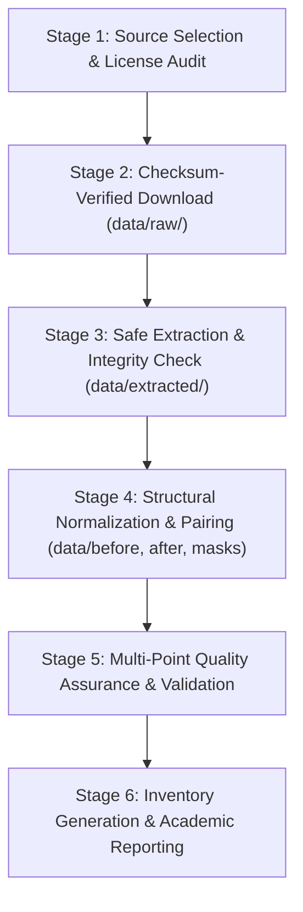

# Dataset Collection, Organization, and Validation Methodology

## 1. Overview and Engineering Workflow

This document outlines the systematic engineering methodology implemented for **Part 1 (Data Pipeline)** of the B.Tech Major Project: *Change Detection Due to Human Activities Using Satellite/Aerial Images*.

The pipeline follows a reproducible six-stage lifecycle:

---

## 2. Methodology Stages

### Stage 1: Dataset Research, Selection, and Licensing Audit
* **Requirement:** Identify datasets with explicit bitemporal image pairs, verified ground truth masks, documented spatial resolutions, and non-commercial academic licensing.
* **Criterion:** Isolate anthropogenic changes (human building construction, urban development, industrial earthworks) rather than environmental fluctuations (seasonal vegetation, tide cycles).
* **Selection:**
  * **LEVIR-CD:** Primary ultra-high resolution ($0.5$ m/pixel) benchmark for building construction.
  * **OSCD:** Secondary multispectral (Sentinel-2, 10m–60m) benchmark for global urban growth.

---

### Stage 2: Automated Ingestion and Cryptographic Verification
* **Tool:** `scripts/download_dataset.py`
* **Mechanisms:**
  * Chunked HTTP streaming to manage network stability.
  * Resumption capability using HTTP `Range` headers.
  * Cryptographic checksum verification (MD5 / SHA-256) matching official upstream release records.
  * Immutable raw archive retention in `data/raw/`.
  * Comprehensive logging in `data/raw/download_manifest.json` recording source URL, byte size, transfer duration, and cryptographic hash.

---

### Stage 3: Safe Archive Extraction
* **Tool:** `scripts/extract_dataset.py`
* **Security & Integrity Protocols:**
  * **Archive Integrity Pre-check:** Calls `zipfile.ZipFile.testzip()` to inspect CRC32 checksums before uncompressing any files.
  * **Zip Slip Vulnerability Mitigation:** Every member path is resolved against `os.path.commonpath` to block directory traversal attacks (`../`).
  * **Preservation of Directory Hierarchy:** Files are extracted into `data/extracted/<dataset_name>/` preserving upstream filenames, extensions, and metadata.

---

### Stage 4: Structural Normalization and Bitemporal Pairing
* **Tool:** `scripts/organize_dataset.py`
* **Standardization Architecture:**
  Upstream datasets vary widely in folder structures (e.g., LEVIR-CD uses `train/A`, `train/B`, `train/label`; OSCD uses per-city directories with `cm/cm.png` and date-stamped band TIFF folders).
  The organization script establishes a clean, unified structure:
  * `data/before/`: Time 1 ($T_1$) pre-change imagery.
  * `data/after/`: Time 2 ($T_2$) post-change imagery.
  * `data/masks/`: Ground-truth binary change masks ($0$ = background / unchanged, $255$ = human activity change).
  * `data/processed/`: Normalized RGB composites and aligned arrays for machine learning training.
* **Non-Destructive Principle:** Raw extracted files are copied/linked into target directories without modifying original files.

---

### Stage 5: Multi-Point Quality Assurance and Validation
* **Tool:** `scripts/validate_dataset.py`
* **Validation Checks:**
  1. **Image Decodability:** Confirms that each image can be read and decoded by Pillow/PIL without truncation or header errors.
  2. **Dimensional Alignment:** Asserts that for every sample ID, `dim(Before) == dim(After) == dim(Mask)`.
  3. **Channel Verification:** Checks channel counts (RGB 3-channel vs single-channel binary masks).
  4. **Mask Value Integrity:** Confirms mask pixel values belong strictly to binary domain $\{0, 255\}$ (or $\{0, 1\}$). Rejects corrupted or non-binary masks.
  5. **Pixel Distribution Analysis:** Calculates the change ratio:
     $$\text{Change Ratio (\%)} = \frac{\sum \text{Changed Pixels}}{\text{Total Pixels}} \times 100$$
     Flags anomalies such as 100% changed masks (potential inversion error) or 0% changed masks where change was expected.
  6. **Completeness & Orphan Check:** Ensures no bitemporal pair lacks a ground truth mask, and no orphan masks exist without imagery.
  7. **Duplicate Detection:** Calculates MD5 hashes across samples to flag unintentional duplicate pairs.

---

### Stage 6: Cataloging, Inventory Generation, and Reporting
* **Tool:** `scripts/generate_inventory.py`
* **Outputs:**
  * `reports/dataset_inventory.csv`: Granular row-by-row catalog containing:
    `sample_id, pair_id, before_file, after_file, mask_file, width, height, channels, format, change_pixel_count, change_percentage, human_activity_type, validation_status`.
  * `reports/dataset_summary.md`: High-level executive summary detailing dataset distributions, split proportions, total storage size, and class balance.
  * `reports/validation_report.md`: Formal verification audit with explicit pass/warn/fail counts.

---

## 3. Academic Non-Fabrication Protocol

This methodology adheres strictly to academic non-fabrication principles:
1. File counts, dimensions, and change ratios reported in `reports/` are dynamically computed from actual disk files.
2. If network access is blocked or a full archive is not downloaded locally, the manifest records the true operational status (`PENDING_LOCAL_DOWNLOAD` or `SAMPLE_VERIFIED`) rather than faking complete download numbers.
3. Every script provides informative exit codes and clear troubleshooting instructions for reproduction.
